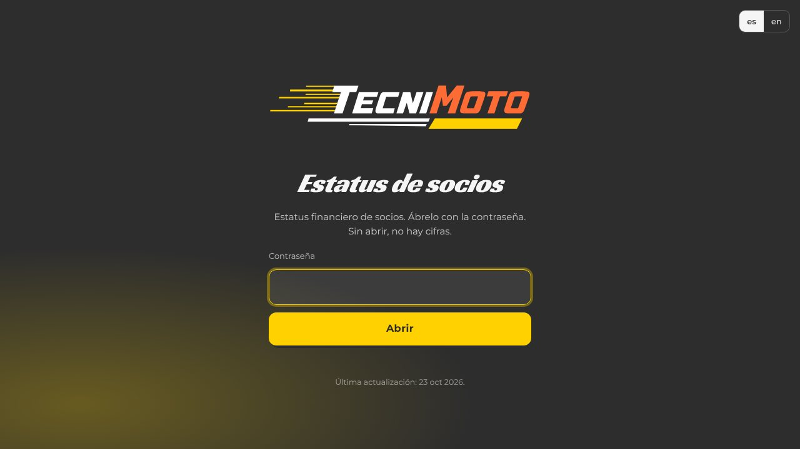
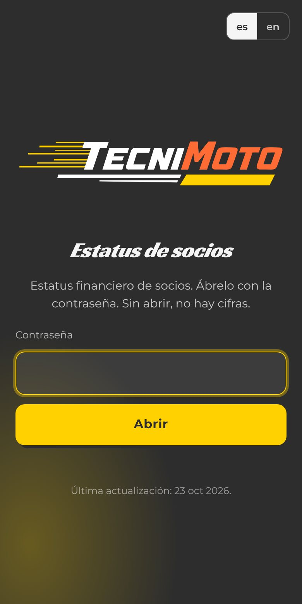

# TecniMoto Status

[English](./README.md) · **Español**

> Página de estatus cifrada para los socios de Tecni Moto.

**[▶ Abrir la página](https://status.tecnimoto.mx/)** · Tecni Moto Garage

## ¿Qué es?

Una página de estatus para los socios de Tecni Moto, servida en [status.tecnimoto.mx](https://status.tecnimoto.mx/). El contenido va cifrado y solo abre con la contraseña de acceso.

## ¿Para quién es?

Para los socios de Tecni Moto que tienen la contraseña. Nadie más puede leerla.

## ¿Qué dolor resuelve?

Compartir el estatus del negocio con los socios sin dejarlo en un chat ni exponerlo en una página pública.

## La propuesta

Una sola página, siempre en la misma dirección, con el contenido cifrado con AES-256-GCM. Sin la contraseña no hay cifras.

## ¿Cómo se usa?

1. Abre [status.tecnimoto.mx](https://status.tecnimoto.mx/).
2. Escribe la contraseña.
3. Lee el estatus. La página muestra la fecha de su última actualización.

## ¿Cuándo conviene y cuándo no?

Conviene para consulta de socios. No es un sitio público de la empresa: el sitio del taller es [tecnimoto.mx](https://tecnimoto.mx).

## ¿Dónde lo pruebo?

  
  

Captura real de la pantalla de acceso, 10 nov 2026. El contenido cifrado no se muestra.

## Hasta dónde llegamos

En línea. Este repo solo tiene la página y el Worker que la sirve; el contenido legible no vive aquí.

## Para quien construye

Worker de Cloudflare `tecnimoto-status` (`worker.mjs`, `wrangler.jsonc`). El estilo sigue [brandkit.tecnimoto.mx](https://brandkit.tecnimoto.mx) (`tokens.css`), no la marca personal de Jorge Suárez.

## Licencia

Este repo no tiene archivo de licencia, así que Tecni Moto Garage conserva todos los derechos sobre el código, el contenido y la marca. Si quieres reutilizar algo, pide permiso primero abriendo un issue.

---

Repositorio mantenido por <a href="https://github.com/jorgefsb">Jorge Suárez</a> · <a href="./README.md">Read in English</a> · Documentación actualizada el 10 nov 2026.

