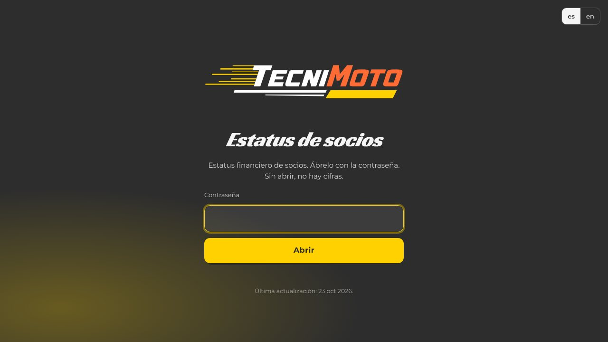
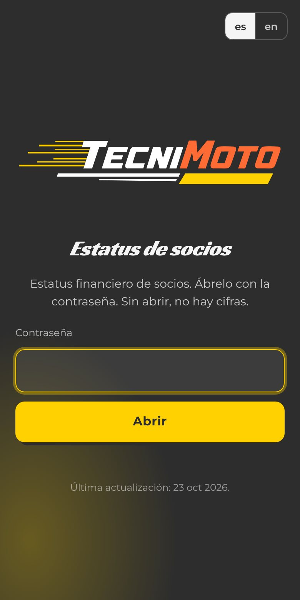

# TecniMoto Status

**English** · [Español](./README.es.md)

> Encrypted status page for Tecni Moto partners.

**[▶ Open the page](https://status.tecnimoto.mx/)** · Tecni Moto Garage

## What is it?

A status page for Tecni Moto partners, served at [status.tecnimoto.mx](https://status.tecnimoto.mx/). The content is encrypted and opens only with the access password.

## Who is it for?

For Tecni Moto partners who have the password. Nobody else can read it.

## What pain does it solve?

Sharing the state of the business with partners without leaving it in a chat or exposing it on a public page.

## The proposal

One page, always at the same address, with the content encrypted with AES-256-GCM. Without the password there are no figures.

## How do I use it?

1. Open [status.tecnimoto.mx](https://status.tecnimoto.mx/).
2. Type the password.
3. Read the status. The page shows the date of its last update.

## When it fits and when it doesn't

It fits for partner lookups. It is not the company's public site: the shop's site is [tecnimoto.mx](https://tecnimoto.mx).

## Where can I try it?

  
  

Real screenshot of the access screen, 10 Nov 2026. The encrypted content is not shown.

## How far we got

Live. This repo only holds the page and the Worker that serves it; the readable content does not live here.

## For builders

Cloudflare Worker `tecnimoto-status` (`worker.mjs`, `wrangler.jsonc`). The skin follows [brandkit.tecnimoto.mx](https://brandkit.tecnimoto.mx) (`tokens.css`), not Jorge Suárez's personal brand.

---

Repository maintained by <a href="https://github.com/jorgefsb">Jorge Suárez</a> · <a href="./README.es.md">Leer en español</a> · Documentation updated on 10 Nov 2026.

